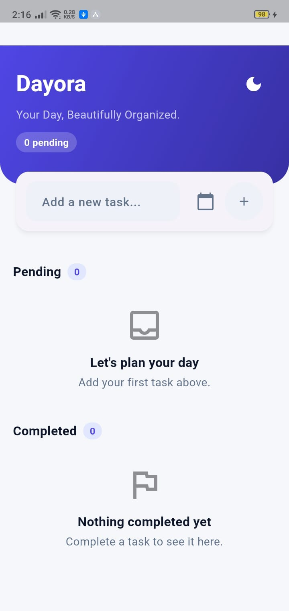
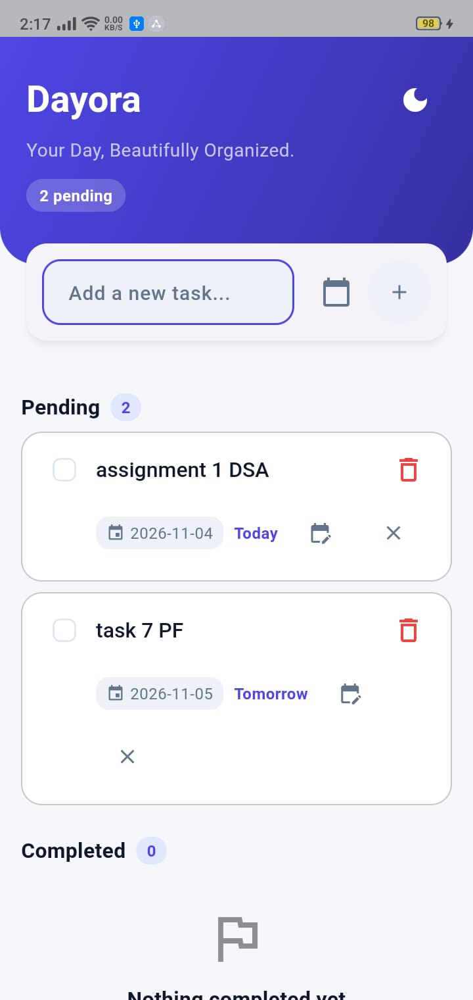
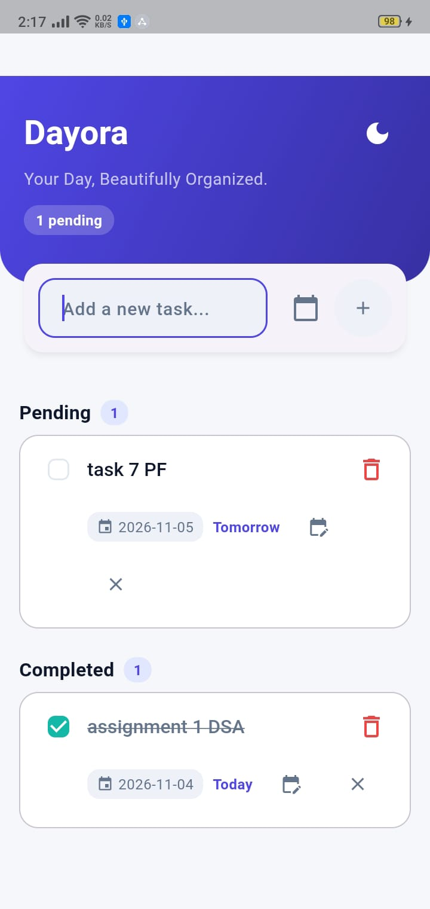
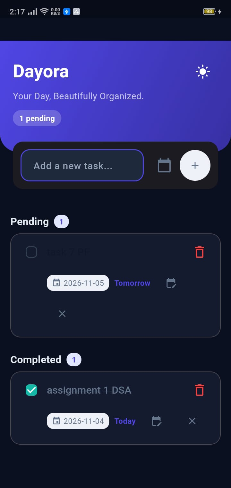

# Dayora

**Your Day, Beautifully Organized.**

Dayora is a modern, polished Flutter To-Do application built with Material Design 3. It helps users capture, track, complete, and remove daily tasks with a clean, distinctive Aurora Indigo interface, optional due dates, and light/dark theme switching.

## Overview

Dayora was developed for the Hunters Group Mobile App Development Internship (Day 01). It replaces the default Flutter starter counter app with a focused, production-quality task manager while keeping the architecture lightweight and maintainable.

## Key Features

- Add tasks with validation for empty or whitespace-only input.
- Display pending and completed tasks in separate sections with accurate counts.
- Mark tasks as completed or move them back to pending.
- Delete tasks instantly.
- Optional due dates with labels: Today, Tomorrow, X days remaining, Overdue by X days.
- Edit or clear an existing due date.
- Light and dark theme switching via an accessible header toggle.
- Responsive, mobile-first layout with safe areas and no overflow.
- Subtle animations and accessible touch targets.
- Clean, modular Flutter code using StatefulWidget and setState.

## Screenshots

> Screenshots are stored in `screenshots/` as JPEG images.

### Home Screen


### Pending Tasks


### Completed Tasks


### Dark Mode


## Technology Stack

| Technology | Purpose |
|---|---|
| Flutter | Cross-platform UI framework |
| Dart | Programming language |
| Material Design 3 | Design system and components |
| StatefulWidget + setState | Local state management |

No third-party runtime dependencies are used beyond the Flutter SDK and `cupertino_icons`.

## Project Structure

```text
lib/
  main.dart
  models/task.dart
  screens/home_screen.dart
  theme/app_theme.dart
  utils/date_labels.dart
  widgets/empty_state.dart
  widgets/task_card.dart
  widgets/task_input.dart
  widgets/task_section.dart
test/
  widget_test.dart
```

## Installation

1. Install Flutter (stable channel) and verify with `flutter doctor`.
2. Clone the repository:
   ```bash
   git clone https://github.com/mairasarwar132/dayora.git
   cd dayora
   ```
3. Install dependencies:
   ```bash
   flutter pub get
   ```

## Run the Application

Run on Chrome:
```bash
flutter run -d chrome
```

Run on an Android device:
```bash
flutter devices
flutter run -d <device-id>
```

## Testing

Run formatting, analysis, and tests:
```bash
dart format lib test
flutter analyze
flutter test
```

Verified results:
- `flutter analyze`: No issues found.
- `flutter test`: 17 tests passed (5 core task tests + 7 date-label tests + 5 Task model tests).

## Android APK Build

```bash
flutter build apk --release
```

The release APK is generated at `build/app/outputs/flutter-apk/app-release.apk`.

## Current Limitations

- Tasks are stored in memory only and are not persisted after app restart.
- Theme selection is not persisted between launches.
- Screenshots in `screenshots/` are currently placeholders and must be replaced with genuine PNG images.

## Documentation

- `PRD.md` — Product requirements and acceptance criteria.
- `ARCHITECTURE.md` — Architecture and data flow.
- `RULES.md` — Coding standards and constraints.
- `PHASES.DOC.MD` — Implementation roadmap.
- `DESIGN.md` — Visual design specification.

## Internship and Project Information

- Project Name: Dayora
- Tagline: Your Day, Beautifully Organized.
- Organization: Hunters Group
- Assignment: Mobile App Development Internship — Day 01
- Deadline: 4 November 2026, 04:00 PM

## Repository

https://github.com/mairasarwar132/dayora
